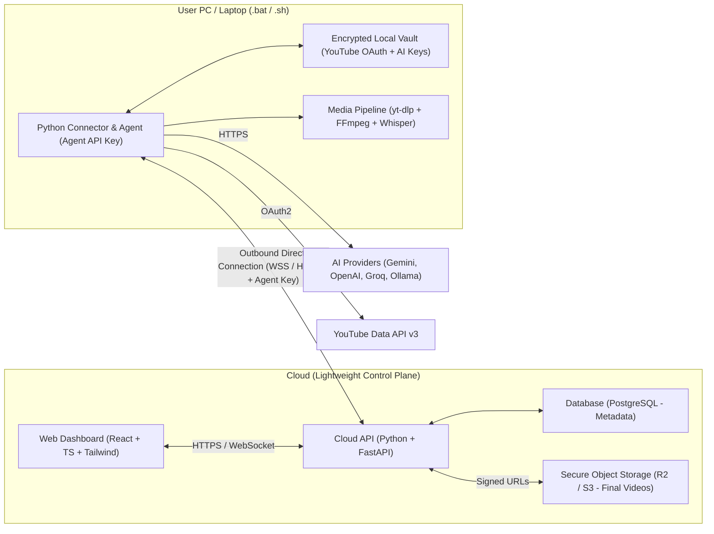

# 🎬 AI YouTube Shorts Clip

> 🇺🇸 **English** | [🇧🇷 Leia em Português](./README.md)


A **full-stack, secure, and cross-platform** (Windows `.bat` and Linux `.sh`) platform for **automated video clipping** (YouTube Shorts and organized export packages for manual posting on TikTok, Instagram Reels, and Kwai).

Built on a **Cloud Control Plane + Local Python Agent** architecture, it keeps **cloud infrastructure costs minimal** while ensuring **maximum privacy**: YouTube OAuth tokens, AI API keys, and heavy video rendering stay 100% on the user's machine.

---

## ✨ Planned Features

- **🎯 Multi-Niche & Multiple AI Providers (*BYOK*):** Choose between **Google Gemini**, **OpenAI (GPT)**, **Groq (Llama)**, **Anthropic (Claude)**, or **Ollama** (100% local) using your own API key.
- **🎨 Full Style Customization & Presets:**
  - Customize subtitle fonts, colors, outlines, shadows, positioning, and animations **before rendering the final video**.
  - Add channel watermarks/logos and pick framing modes (`9:16` centered, background blur, split-screen, or auto-reframe).
  - Create, save, and reuse custom **Clipping Presets** per niche.
- **🌍 Multi-Language Subtitles:** Automated audio transcription and subtitle generation powered by `faster-whisper`.
- **📺 Detailed Multi-Channel Management with Weights:**
  - Connect multiple YouTube channels and view OAuth status, niche, quota, and upload history.
  - Distribute Shorts automatically using **configurable weights** (e.g., Channel A weight `3`, Channel B weight `1`).
  - Export ready-to-post folders (video, title, description, and manual posting guide) for TikTok, Reels, and Kwai.
- **⚡ Real-Time Web Dashboard:** Track every pipeline step (`download` → `transcription` → `AI analysis` → `rendering` → `upload`) live via WebSockets.
- **🔌 Connector Agent with Auto-Update:** Lightweight Python connector (`connector.py`) authenticated via a **User-Generated Agent API Key** (revocable/regenerable anytime from the dashboard), featuring modular auto-updates verified with `SHA-256`.
- **☁️ Secure Storage for Approved Videos:** Metadata stored in PostgreSQL and optional final videos stored in **private Object Storage** (Cloudflare R2 / S3) via temporary signed URLs.

---

## 🏗️ System Architecture



---

## 🛠️ Tech Stack & Tools

| Layer | Technologies | Role |
| :--- | :--- | :--- |
| **Local Agent** | Python 3.12+, `yt-dlp`, `FFmpeg`, `faster-whisper`, `OpenCV`/`MediaPipe` | Video download, transcription, `9:16` face tracking, cutting, and local rendering. |
| **Local Security** | `cryptography` (Fernet/AES), `SHA-256`, `google-auth-oauthlib` | Local key encryption, auto-updater integrity checks, and YouTube OAuth2. |
| **Cloud Backend** | Python, **FastAPI**, SQLAlchemy, Alembic, JWT + Argon2, `boto3` | User accounts, agent keys, job orchestration, WebSockets, and signed URLs. |
| **Database & Storage** | **SQLite** (local) / **PostgreSQL** (cloud) + **Cloudflare R2 / S3** | Metadata, presets, channels/weights, and temporary storage for approved videos. |
| **Web Dashboard** | **React**, **TypeScript**, **Vite**, **Tailwind CSS**, Lucide Icons | Clean, responsive, real-time web interface hosted in the cloud. |
| **Quality & Runners** | `start.bat` (Windows), `start.sh` (Linux), Pytest, Ruff, Docker | One-command setup/launch, automated testing, and code linting. |

---

## 🚀 Getting Started (Work in Progress)

> [!NOTE]
> This project is currently in its initial planning and setup phase. Below is the planned user workflow for the Local Agent:

1. Open the Web Dashboard, create an account, and generate your **Agent API Key**.
2. Download the Local Agent package and paste your key into the configuration file.
3. Launch according to your OS:
   - **Windows:** double-click `start.bat` (or run from terminal).
   - **Linux / macOS:**
     ```bash
     chmod +x start.sh
     ./start.sh
     ```

---

## 🗺️ Roadmap (Step-by-Step Build)

- [x] **Phase 1 — Documentation & Architecture:** Scope definition, viability analysis, bilingual `README`, and MIT License.
- [ ] **Phase 2 — Local Engine (CLI MVP):** Python + `yt-dlp` + `FFmpeg` + `faster-whisper` script for downloading, `9:16` cropping, and basic subtitles.
- [ ] **Phase 3 — Backend & Database:** FastAPI + SQLite/PostgreSQL with user accounts, Agent API Key generation/rotation, and job queue.
- [ ] **Phase 4 — Web Dashboard:** React + TypeScript + Tailwind UI with authentication, preview, full style customization, and real-time progress.
- [ ] **Phase 5 — Connected Agent & Advanced Features:** `connector.py` with `SHA-256` auto-updates, multiple AI providers, weighted multi-channel distribution, Cloudflare R2, and `.bat`/`.sh` launchers.

---

## 🤝 Contributing

Contributions, feature suggestions, partnerships, and code reviews are very welcome!

1. **Fork** the repository.
2. Create a feature branch (`git checkout -b feat/my-feature`).
3. Commit your changes (`git commit -m 'feat: add my feature'`).
4. Push to your fork (`git push origin feat/my-feature`) and open a **Pull Request**.

Feel free to also open an **Issue** with ideas, questions, or bug reports.

---

## 👨‍💻 About the Author

Designed and built during my **2nd semester in Software Engineering** at **Federal University of Ceará (UFC) — Quixadá Campus**, focused on hands-on learning, software architecture, security, and building a strong engineering portfolio.

> 💡 **Open to opportunities:** Looking for **internships, junior roles, technical partnerships, and project collaborations** in software engineering, automation, and AI.

- **GitHub:** `[Updating soon]`
- **LinkedIn:** `[Your LinkedIn here]`
- **Email:** `[Your Contact Email here]`

---

## 📄 License

This project is licensed under the **MIT License**. See [LICENSE](./LICENSE) for details.
