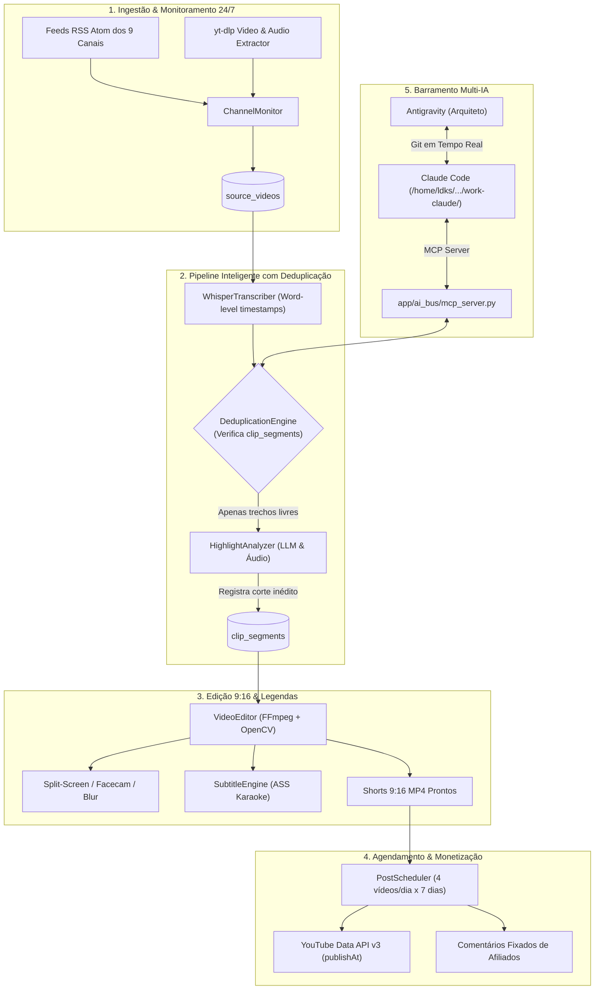

# 🎬 AI YouTube Shorts Clip

> 🇧🇷 **Plataforma Full-Stack Inteligente para Monitoramento 24/7, Geração Automática de Shorts 9:16 e Agendamento Multicanal**


---

## 🚀 Funcionalidades Principais

- **📡 Monitoramento 24/7 de 9 Canais Principais:**
  - `Lucas A.R.T. CORTES` (`@7mz_lucasart`)
  - `LipaoGamer` (`@LipaoGamer`)
  - `Paulinho LOKO Lives` (`@ModderClips`)
  - `Flakes Power` (`@FlakesPower`)
  - `alanzoka` (`@alanzoka`)
  - `Davy Jones GTA 6` (`@DavyJonesGTA6`)
  - `Games EduUu` (`@GamesEduUu`)
  - `piuzinho` (`@piuzinho`)
  - `LOUDCoringa` (`@LOUDCoringa`)
  - Utiliza **Feeds RSS Atom/XML Nativos do YouTube** + fallback `yt-dlp` para detecção contínua sem gastar cota da API do YouTube!

- **🛡️ Banco de Dados com Memória de Deduplicação de Trechos:**
  - Tabela `clip_segments` registra os segundos exatos (`start_time`, `end_time`) de cada corte realizado.
  - O motor de deduplicação impede **100% de reutilização ou sobreposição** de trechos já cortados anteriormente.
  - Oferece cálculo de **janelas virgens/livres** (`get_available_windows`) para alimentar IAs apenas com momentos inéditos.

- **📅 Agendador de Monetização (4 Vídeos por Dia x 7 Dias):**
  - Matriz de agendamento semanal com **28 slots de pico** por canal de monetização (11:30, 15:00, 18:30, 21:00 BRT).
  - Preenchimento automático de vagas conforme novos clipes são renderizados.
  - Suporte à publicação agendada oficial via **YouTube Data API v3** com parâmetro `publishAt`.
  - Inserção de comentários fixados com links de afiliados/monetização.

- **🎨 Renderização 9:16 com Legendas Dinâmicas Karaoke:**
  - **Modo Split-Screen Gamer:** Topo com a Facecam do streamer e parte inferior com gameplay de ação (ideal para GTA 6, Paulinho Loko, Alanzoka).
  - **Modo Auto-Reframe:** Rastreamento facial com OpenCV.
  - **Modo Fundo Desfocado (Blur Background):** Gameplay 16:9 centralizada sobre fundo 9:16 desfocado.
  - **Legendas Dinâmicas `.ass`:** Animação palavra a palavra sincronizada com a fala (`faster-whisper`), com cores vibrantes e bordas pretas para alta legibilidade no celular.

- **🤖 Barramento Multi-IA & Orquestração do Claude Code:**
  - Integração nativa com **Claude Code** (`npm install -g @anthropic-ai/claude-code`) e **Open Code**.
  - Servidor **MCP (Model Context Protocol)** embutido (`app/ai_bus/mcp_server.py`).
  - Bridge de sincronização Git em tempo real para desenvolvimento conjunto na máquina local (`/home/ldks/Documents/work-claude/`).

---

## 🏗️ Arquitetura do Sistema



---

## ⚡ Como Conectar o Antigravity com o Claude Code em Tempo Real

### No seu ambiente local (`/home/ldks/Documents/work-claude/`):

1. **Clone o repositório:**
   ```bash
   cd /home/ldks/Documents/work-claude/
   git clone https://github.com/LANOSGITUFC/AI-YOUTUBE-SHORTS-CLIP.git .
   ```

2. **Inicie o Sync Bridge em tempo real:**
   ```bash
   python3 sync_bridge.py
   ```
   *O `sync_bridge.py` monitora os commits do Antigravity, executa o Claude Code nas missões enviadas e faz commit automático de volta no Git.*

3. **Configuração do MCP no Claude Code (`claude_desktop_config.json` ou `mcp.json`):**
   ```json
   {
     "mcpServers": {
       "shorts-clipper": {
         "command": "python3",
         "args": ["-m", "app.ai_bus.mcp_server"],
         "cwd": "/home/ldks/Documents/work-claude/"
       }
     }
   }
   ```

---

## 🖥️ Como Executar a Aplicação e o Dashboard

### Linux / macOS:
```bash
chmod +x start.sh
./start.sh
```

### Windows:
Dê um duplo clique em `start.bat`.

### Manual:
```bash
python3 run.py
```
O painel estará disponível em: **`http://localhost:8000`**

---

## 📄 Licença

Distribuído sob a licença **MIT**. Veja `LICENSE` para mais informações.
